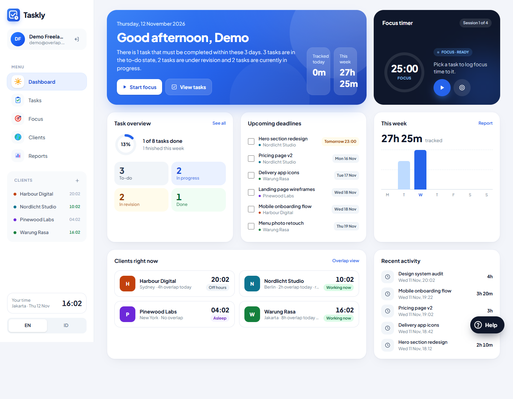
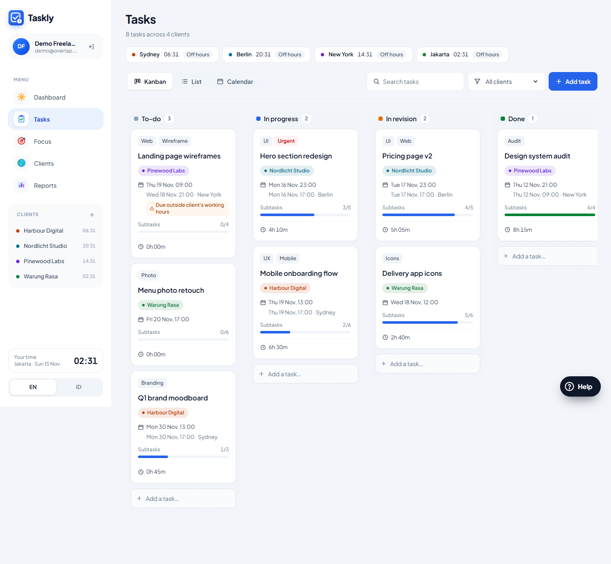
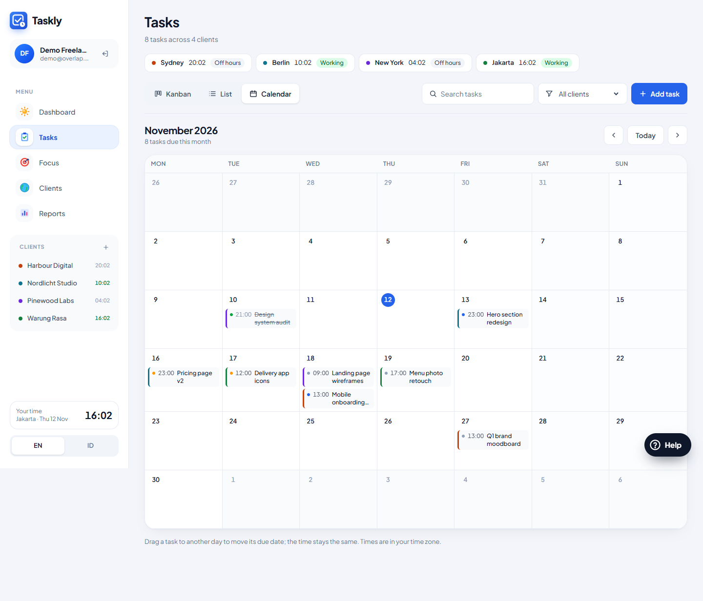
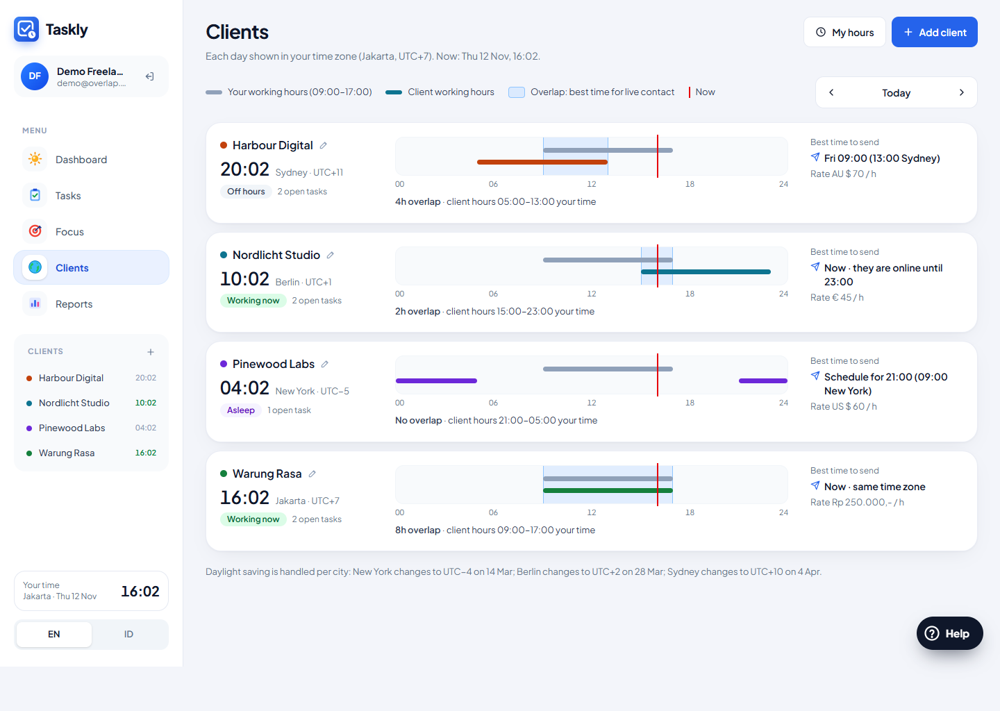
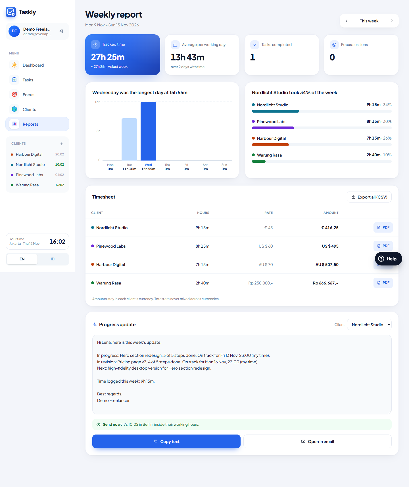
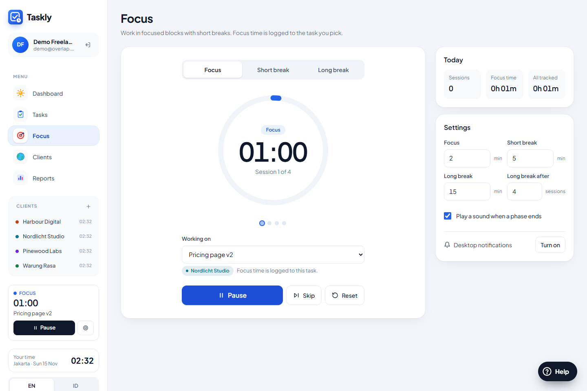
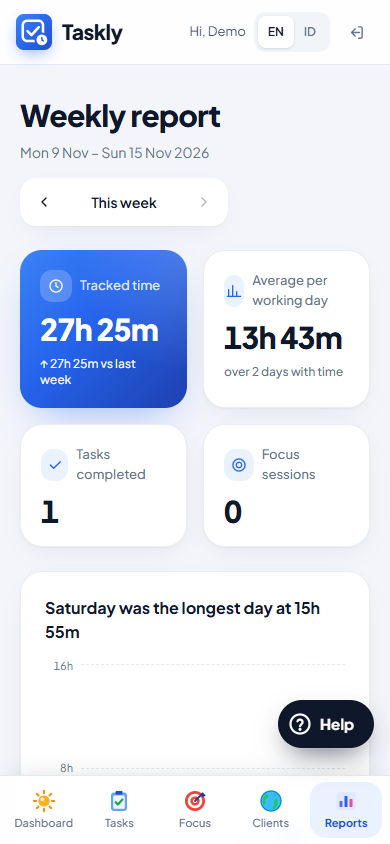
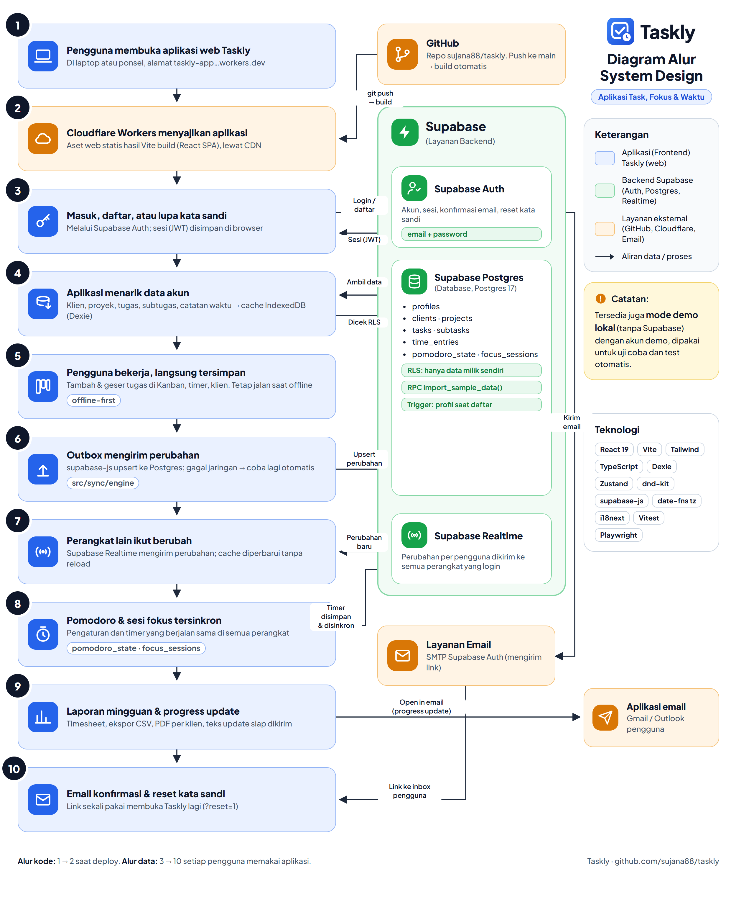

# Taskly

**Task, focus and time manager for freelancers who work with clients in other time zones.**

Taskly keeps your tasks, deadlines, tracked hours and client relationships in one place, and it
always answers the freelancer's daily question: *"What time is it for my client, and when should I
send this?"* Every deadline is shown in your zone and the client's, every client card shows their
local time and your working-hours overlap, and the weekly report turns tracked time into a
timesheet and a ready-to-send progress update.

**Live app:** https://taskly-app.time16.workers.dev



---

## Features

### Tasks
- **Kanban board** (To-do, In progress, In revision, Done) with drag and drop, by mouse, touch or keyboard.
- **List view** with sortable columns, and a **Calendar view** that places each task on its due day.
  In the calendar you can drag a task to another day to reschedule it, or use **+** on a day to add one.
- **Task drawer** for the title, status, project, deadline, tags, subtasks, notes and time tracking.
- **Two-zone deadlines.** A deadline is shown in your time and the client's, with a warning when it
  falls outside the client's working hours.
- **Search and client filter**, kept in the URL so a view can be bookmarked.

### Focus and time tracking
- **One global timer** that survives reloads and is always visible in the sidebar.
- **Manual time entries**, which can also be deleted.
- **Pomodoro focus mode** with focus, short break and long break (25/5/15 by default, all adjustable).
  Focus time is logged to the task you pick. A chime and an optional desktop notification mark the
  end of each phase.
- **Pomodoro settings and the live timer sync across devices.**

### Clients across time zones
- **Each client shows** their local time, UTC offset and status (working, off hours, asleep).
- **A 24-hour timeline** shows your hours, their hours and the overlap, plus the best time to send a message.
- **Daylight saving is handled per city**, and the page lists each zone's next clock change.
- **Client details:** contact name, email, phone (country code picker), website, note, hourly rate and currency.
- **Clear money format:** US $, AU $, NZ $, CA $, SG $, €, ¥ and Rp 250.000,-.

### Weekly report
- **Summary tiles:** tracked time against last week, average per working day, tasks completed and focus sessions.
- **Charts:** hours per day and time share per client.
- **Timesheet per client** with hours, rate and amount in the client's own currency.
- **Exports:** a CSV of every entry, and a printable PDF per client.
- **Progress update** drafted from the week's work, with a "send now / send later" hint based on the
  client's working hours. Copy it, or open it in your email app.

### Everything else
- **Dashboard** with a greeting, a "due within 3 days" summary, the focus timer, upcoming deadlines,
  this week's hours, clients right now and recent activity.
- **Accounts** with sign up, log in, forgot password (email link) and a profile page where you can
  change your name, working hours and password.
- **English and Indonesian** interface.
- **Help centre** with a guide per page, terms, FAQ and keyboard shortcuts.
- **Works on phones**, with a bottom tab bar on small screens.

<table>
  <tr>
    <td></td>
    <td></td>
  </tr>
  <tr>
    <td></td>
    <td></td>
  </tr>
  <tr>
    <td></td>
    <td></td>
  </tr>
</table>

---

## Tech stack

| Area | Tools |
|---|---|
| UI | React 19, TypeScript, Tailwind CSS 4, React Router (hash routes) |
| Drag and drop | dnd-kit |
| Dates and time zones | date-fns, @date-fns/tz |
| Local data | Dexie (IndexedDB), zustand |
| Backend | Supabase: Auth, Postgres with Row Level Security, Realtime |
| i18n | i18next (English, Indonesian) |
| Build | Vite |
| Tests | Vitest + Testing Library (unit), Playwright (end-to-end) |
| Lint | oxlint |
| Hosting | Cloudflare Workers (static assets), deployed on every push to `main` |

## Architecture



Taskly is **offline-first**:

1. **The UI only reads from IndexedDB** (via Dexie), so pages render instantly and keep working offline.
2. **Every local change is added to an outbox**, which is kept across reloads. The outbox is flushed
   to Supabase shortly after each change and again when the device comes back online. Parents are
   sent before children.
3. **On sign-in, the account is pulled from Supabase.** After that, Realtime brings in changes made on
   other devices.
4. **Logging out wipes this device's copy.**

Every table carries a `user_id` and is protected by **Row Level Security**: a signed-in user can only
read and change their own rows, and anonymous requests have no access. A new account gets its profile
and Pomodoro row from a database trigger.

The app can also run in **local mode** (`VITE_BACKEND=local`), with no server at all: a demo account
and sample data live in the browser. The unit and end-to-end tests always use local mode.

## Getting started

Requirements: **Node.js 20.19+ or 22.12+** and npm.

```bash
git clone https://github.com/sujana88/taskly.git
cd taskly
npm install
npm run dev
```

Open http://localhost:5173.

### Choosing a backend

The app picks its mode from environment variables (in `.env`):

| Mode | Variables | What you get |
|---|---|---|
| **Supabase** | `VITE_SUPABASE_URL`, `VITE_SUPABASE_PUBLISHABLE_KEY` | Real accounts, data synced across devices |
| **Local** | `VITE_BACKEND=local` (or no Supabase variables) | Demo account, data stays in this browser |

The Supabase URL and publishable key are public values: they are meant to be shipped to the browser,
and Row Level Security protects the data. **Never put a service-role or secret key in `.env`.**

To try local mode quickly:

```bash
node node_modules/vite/bin/vite.js --mode e2e
```

Then use **"Try the demo account"** on the login page.

### Setting up your own Supabase project

1. Create a project at [supabase.com](https://supabase.com).
2. Apply the SQL files in [`supabase/migrations/`](supabase/migrations) in order. You can use the
   Supabase CLI (`supabase db push`) or paste each file into the SQL editor.
3. Put the project URL and publishable key in `.env`.
4. In **Authentication → URL Configuration**, set the Site URL to where the app is hosted. Add it and
   `http://localhost:5173` to the redirect URLs, so confirmation and password-reset emails link back
   to the app.
5. Optional: a new account can fill itself with demo data from the dashboard's **Import sample data**
   card, which calls `public.import_sample_data()`.

## Scripts

| Command | What it does |
|---|---|
| `npm run dev` | Start the dev server on port 5173 |
| `npm run build` | Type-check and build the static site into `dist/` |
| `npm run preview` | Serve the built site |
| `npm run lint` | Lint with oxlint |
| `npm test` | Unit tests (Vitest, local mode) |
| `npm run e2e` | End-to-end tests (Playwright, builds in local mode) |

The end-to-end tests use the locally installed Chrome. If you don't have it, run
`npx playwright install chromium` once and switch the `channel` setting in `playwright.config.ts`.

> **Windows note:** the npm scripts call `node node_modules/...` directly instead of the usual
> `.bin` shims, because those shims break when the folder path contains `&`.

## Project structure

```
src/
  components/       Shared UI: sidebar, modal, icons
  db/               Dexie schema, types and demo seed data
  features/
    auth/           Login, sign up, forgot/reset password, session, route guard
    clients/        Clients page, client form, overlap timeline
    dashboard/      Dashboard home
    focus/          Pomodoro focus page
    help/           Help centre content and panel
    profile/        Profile and password change
    reports/        Weekly report, charts, CSV/PDF export, progress update
    tasks/          Kanban board, list, calendar, task drawer
    timer/          Global timer, Pomodoro store and controller
  hooks/            Small React hooks (e.g. a ticking clock)
  i18n/             English and Indonesian strings
  lib/              Pure, unit-tested logic: time zones, overlap, Pomodoro,
                    reports, calendar, currency, phone numbers, colours
  sync/             Supabase sync engine, mappers, session handling
supabase/migrations/  Database schema, RLS policies, grants, Realtime
e2e/                Playwright end-to-end tests
docs/               Architecture diagram and screenshots
```

## Notes

- **Data keys:** the IndexedDB database and some localStorage keys still use the old project name
  (`overlap`), so data saved before the rename to Taskly is kept.
- **Time zones:** all time-zone math works on real instants, so daylight-saving changes are handled
  correctly for each city.
